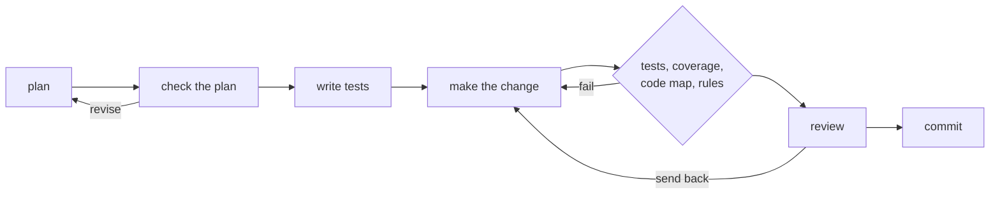

# code-ratchet

Find what is wrong with a Python project's design, then fix it one small, tested step at a
time, using a team of Claude agents that run on your Claude subscription.

## What it is

code-ratchet is a command-line tool for Python projects. It lets you:

- **Audit a project.** Agents read the code and write a list of problems, each backed by
  lines quoted from the code. You answer their questions and approve the list before it is
  saved.
- **Refactor it, one problem at a time.** For each problem, agents plan a change, write
  tests, make the change and review it. Plain code checks the work between agents.
- **Keep only what passes.** A change that passes every check is committed. A change that
  keeps failing is undone. Like a ratchet, the code only moves forward.
- **See the history of every problem**: when it was found, worked on, finished or reopened.

## Why it exists

AI agents write code quickly, but they also cut corners, wander outside the task, and say
they are done when they are not. Asking more agents to check the work only helps so much,
because they make the same kinds of mistakes.

code-ratchet surrounds the agents with checks that are ordinary code: the test suite, a check
that every changed line is tested, a map of which functions call which, and the project's own
design rules. An agent's work goes forward only when those checks pass.

It is built on [agent-rooster](https://github.com/nikhilchandra/agent-rooster), which runs
each agent through Claude Code on your plan and keeps it inside strict limits on files and
commands.

## What you need

- Python 3.13 or newer
- [uv](https://docs.astral.sh/uv/), a Python package manager, and git
- [Claude Code](https://docs.claude.com/en/docs/claude-code), installed and signed in with
  your Claude plan
- A Python project that uses git and pytest, with its tests passing

## Install

```bash
git clone https://github.com/nikhilchandra/code-ratchet
cd code-ratchet
uv sync
uv run pytest        # runs the tests, with no calls to Claude
```

You install `code-ratchet`, and the command you type is `ratchet`. To use it on your own
projects, install the command once:

```bash
uv tool install git+https://github.com/nikhilchandra/code-ratchet
```

## Try it on the example

[examples/shop](examples/shop) is a 40-line project made for trying ratchet. It has two design
problems left in on purpose: `receipt.py` works out the total itself, copying the tax rate,
and `pricing.py` prints a message, although its rules say only the command line may print. Its
settings use a cheaper model and small caps, so a first run uses little of your plan.

**1. Set up a copy.** ratchet works on a project that is its own git repository, so it cannot
run inside this one. From this repository's root, give the script a folder that does not exist
yet:

```bash
uv run python examples/shop/try_it.py ~/shop                        # macOS or Linux
uv run python examples/shop/try_it.py C:/Users/you/Desktop/shop     # Windows
```

It copies the example there, makes the copy a git repository with one commit, and runs
`ratchet init`. It calls no agent. Then go to the copy with `cd`, using the folder you gave.

**2. Read the two files you would write for your own project.**

- `.ratchet/rules.md` says how the code should be organized: what the project is for, its
  parts, which part may use which, and which parts may touch the outside world, such as
  printing. A block at the end states the same rules in a form that plain code can check.
- `.ratchet/config.toml` says how to run the tests, which files agents may change, and how much
  each agent may use.

**3. Audit the code.**

```bash
ratchet audit -p "look at how the total is worked out"
```

The `-p` text tells the agents where to look first. ratchet runs its own code checks, then the
agents read the code and compare it with your rules. If they have questions, ratchet asks them
in the terminal. Then it shows a summary of the draft list and offers `[a]pprove`, `[e]dit`,
`[d]iscard` or `[l]ater`. Approve it, and the list is saved in `.ratchet/`. It should hold the
two planted problems, and it may find more.

**4. Read the list.**

```bash
ratchet problems        # one line for each problem
ratchet problems P1     # the full entry for one problem
```

An entry looks like this:

```markdown
### P1. The receipt works out the total itself

Status: open
Grade: stated (Breaks: "pricing is the only place that knows the tax rate")
Subject: shop.receipt.receipt
```

**5. Fix one problem.**

```bash
ratchet refactor --max-jobs 1
```

ratchet prints one line for each step of the job: the plan, the check of the plan, the tests
written first, the change, the test run, the checks, and the review. If the change passes, it
is committed. Run `git log` and `git show` in the copy to see it. If it keeps failing, it is
undone and the code is as it was.

**6. Follow a problem.**

```bash
ratchet problems P1 --history
```

This shows everything that happened to the problem: when the audit found it, when a job
started on it, and when it was finished. Run `ratchet refactor` again for the next problem.

## Start with your own project

In a Python project that uses git and pytest, with nothing uncommitted and its tests passing:

1. **`ratchet init`** creates `.ratchet/`, with a `config.toml` and a `rules.md` to fill in. It
   keeps them in a git repository of their own, out of your project's history.
2. **Fill in `.ratchet/rules.md`,** using the shop example's as a guide, and set the test
   command in `.ratchet/config.toml`.
3. **Run `ratchet audit`, then `ratchet refactor --max-jobs 1`,** as in steps 3 to 6 above.

The default settings use stronger models and larger caps than the example, so an audit of a
real project uses a good share of your plan. You can lower them in `config.toml`.

## How an audit works

1. An **auditor** reads the code and writes the problems it finds.
2. Two **reviewers** check that list: one against your rules for the project, one against a
   general standard of good design. Each may add problems the auditor missed.
3. Plain code **groups the findings** that describe the same problem, and checks that every
   line an agent quoted really is in the code.
4. A **final judge** decides each group: keep it, merge it, drop it, or ask you a question.
5. **You** answer the questions and approve the draft. Only then is the list saved.

A later audit also rechecks the old list. It runs a **blind auditor**, which cannot see the old
list, beside an agent that checks each old problem against the code as it is now. The blind
auditor cannot open ratchet's own files, git's files or anything git ignores, such as `.env`.

## How a refactor job works

Each job takes one problem from the list through these steps:



A few things to know:

- **A planner** picks the next problem and plans the change. **A super-planner** checks that
  plan against the rest of the code, using a map of which functions call which.
- **A test writer** writes tests first. Because a refactor must not change what the code
  does, these tests must pass on the current code, and the agent making the change may not
  edit them.
- **The checks between agents are plain code**: the test suite, a check that every changed
  line is run by a test, a check that the change touched only what the plan named, and the
  project's design rules.
- **A reviewer** judges the finished change, and can send it back with what to fix.
- **A change that passes is committed.** One that fails too many times is undone, and the
  run moves on to the next problem.
- **Only one run happens at a time.** If ratchet crashes, the next run undoes the unfinished
  work and starts clean.

## Where ratchet keeps its records

Everything ratchet knows about a project lives in a `.ratchet/` folder at the project's root:
your rules, the settings, every problem list and the history of each problem. That folder is
its own git repository, kept out of the project's history, so the project's commits stay
about the code.

## About using your subscription

ratchet runs many agents, so it uses up your plan's usage limits faster than everyday use.
Every audit and every agent has a usage cap, measured at API prices. On a subscription,
nothing is billed. See agent-rooster's
[notes on using a subscription](https://github.com/nikhilchandra/agent-rooster#about-using-your-subscription)
for what Anthropic's terms allow.

## What it does not do yet

- It works on Python projects that use pytest.
- It refactors. Commands for building new features and fixing bugs are planned.

## Where to start reading the code

- `src/ratchet/refactor/job_graph.py`: the steps of one refactor job.
- `src/ratchet/audit/audit_graph.py`: the steps of an audit.
- `src/ratchet/pathways.py`: the map of which functions call which.
- `docs/scenarios.md`: every way ratchet is used, start to finish, in plain steps, with the
  tests that cover each one.

[docs/reference.md](docs/reference.md) has the full details: the settings, how to write your
rules, the format of a problem list, and the records repository.

## Tests

```bash
uv run pytest            # free, with no calls to Claude
uv run pytest -m live    # one real audit on a tiny project, which uses a little of your plan
```

## License

MIT. See [LICENSE](LICENSE).
